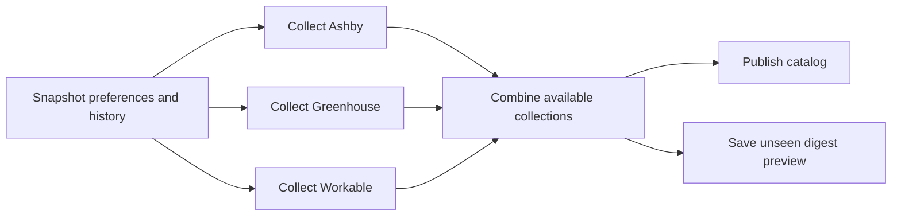

# bet’s board

A static job catalog for the fork, published at https://p1va.github.io/ashby-job-radar/.

It includes **every currently listed role matching the radar's location and title preferences**, including roles already emailed. It uses the same predicates as catch-up, with no sent-history check, publication cutoff or 100-role cap. Berlin, Munich and remote Germany are the current focus. This is a matching catalog, not every worldwide role at those companies.

The default view groups roles by company. Search covers company, title, locations, department and full descriptions; uncheck “Search job descriptions, too” to narrow it. Words are combined with AND; quotes keep phrases together. Location and work-style selections use OR within each filter, AND between filters. Filters and job details can be shared using the page URL. Sorting, a flat role view and a mobile filter panel are included.

Company names, websites, logos and board introductions come from a separately refreshed [company cache](../company-info/README.md). The shared featured list starts with the original 42 company seeds. Featured badges, a featured-only filter and “Featured first” sorting highlight those companies without changing ordinary role eligibility.

## Refresh

In the fork's **Actions → Publish job board → Run workflow**, or wait for the daily 06:35 UTC run. Changes to the catalog code and company sources also trigger a rebuild.

The workflow snapshots the original repository's current role/location preferences, company sources and sent history at one commit, with the fork's own `sources` setting. It combines them with the fork's registry, embedded boards and discovery seeds. Ashby boards are fetched once; Greenhouse uses a light list and a second board request when matching candidates need descriptions. Both use compression and bounded retries. The **Listed on** filter selects providers, including shareable `?source=greenhouse` links. See [additional sources](../discovery/README.md) for backfills and Workable's paced Germany search.

No email is sent and no registry or sent history is changed. This workflow requires no search API key or SMTP secrets. The report artifact includes a full HTML/Markdown/CSV/JSON **catch-up digest preview**: all unseen current matches from fresh collections, with no daily date cutoff or result cap. It is not the existing daily email's selection policy. The original email workflow remains separate.

## Independent source steps



`sources` in config chooses the parallel Actions matrix. Each job calls the same
collector with `--source ... --collect-only` and uploads matching normalized
jobs plus its complete run report. The artifacts contain only matches, rather
than hundreds of thousands of unrelated jobs. `fail-fast: false` lets the other
providers finish after one fails. The combine job runs after failures too and
uses the common preferences/provenance to reject incompatible artifacts.

A 404 removes a dead board from that build. Within each provider, up to one
failed board in twenty is tolerated and labelled partial. An incomplete global
Workable walk rejects that whole provider collection. When a provider fails,
the catalog can reuse its previously published matches for **48 hours**, only
if the preferences hash still matches. It preserves the original collection
timestamp on every fallback; repeated failures never extend the deadline.
Stale results and unavailable sources are named beside the refresh date.
Expired or incompatible results are omitted. If every source fails, publication
is withheld. A successful empty result removes that source's old jobs.
If the previous site itself cannot be read, healthy sources still publish;
affected providers are visibly unavailable rather than silently treated as empty.

The catch-up preview uses fresh collections only, so fallback jobs cannot be
treated as newly checked or sent. It reads the snapshot of sent history and
never changes it. The Actions graph still shows failed provider jobs as failures,
even when the combine and deployment jobs succeed with partial results. Each
provider artifact and the combined report are retained for 30 days. Branch runs
save the full site/digest artifact; only `main` can publish Pages.

Legacy `build.py` without `--collect-only` remains an all-in-one local command.
It retains its existing stricter publication policy. The failure isolation and
48-hour fallback belong to the Actions combine path.

To send a real daily email from this pipeline later, add a delivery job using
the fresh normalized collections, the existing eligibility/date rules and sent
history, and advance delivery state only after successful sending. This fork
currently produces a preview artifact without SMTP credentials.

## Local use

Python 3.9+ and the standard library are sufficient:

```sh
python -B job-board/build.py --out /tmp/bets-board-build
python -m http.server 8000 --directory /tmp/bets-board-build/site
```

Open http://localhost:8000/. For a small live check, add `--board company-slug` (repeatable). To replay saved board responses, add `--fixtures path/to/boards`; each `<slug>.json` should contain `{"jobs": [...]}`. Output must be a new directory.

For a local pipeline run, collect each configured provider to its own folder
(the commands can run concurrently), then combine:

```sh
python -B job-board/build.py --source ashby --collect-only --out /tmp/collections/catalog-source-ashby
python -B job-board/build.py --source greenhouse --collect-only --out /tmp/collections/catalog-source-greenhouse
python -B job-board/build.py --source workable --collect-only --out /tmp/collections/catalog-source-workable
python -B job-board/combine.py --config config.json --seen seen.json \
  --collections /tmp/collections --out /tmp/combined-board
```

The combine command uses the sources enabled in `config.json`. Add
`--previous path/to/previous-jobs.json` to exercise fallback offline, or
`--previous-url https://p1va.github.io/ashby-job-radar/` to read the live board.

```sh
python -B -m unittest discover -s job-board -p 'test_*.py'
```

`build.py` selects records and writes HTML plus one JSON file. `index.html`, `styles.css` and `app.js` are the whole front end: no framework, package install or backend. Descriptions render as plain text, and employer HTML is never inserted into the page. Assets use relative, content-hashed paths so the site works under a GitHub Pages repository path without mixing cached versions. The collection is small enough to filter directly in the browser.

GitHub Pages must be enabled with **Source: GitHub Actions** in the fork's repository settings. `.github/workflows/job-board.yml` is restricted to this fork, so adding these files upstream does not automatically publish there.

Company display names use cached Ashby profiles or the provider's advertised company name, falling back to a board slug. Location and work-style labels come from job postings; they are not verified company headquarters. Older publication dates may still correspond to open listings. Follow the original posting for current availability and application details.
